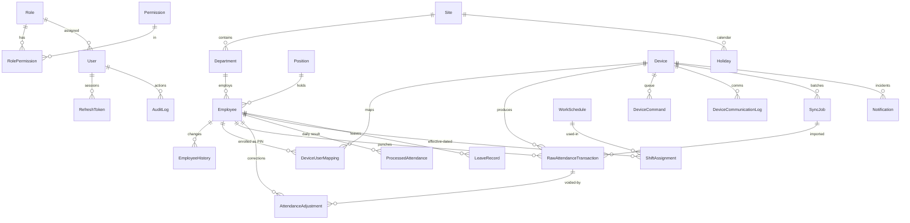

# ADMS — Architecture (Phases 1–2)

## 1. Requirements analysis — key decisions

| Requirement | Decision |
|---|---|
| Different terminals use different protocols | `DeviceAdapter` interface per protocol (`ZK_PUSH`, `ZK_SDK_LAN`, `VENDOR_API`, `MOCK`). Nothing assumes one protocol. |
| Never show a device online without evidence | Status is **computed** from `lastSeenAt`, which is written only by an authenticated device request. Configuration, IP pings and mock data never change it. |
| No silent edits of punches | `RawAttendanceTransaction` is append-only. Corrections are `AttendanceAdjustment` rows (ADD_PUNCH / VOID_PUNCH) with reason, requester, approver. |
| Duplicate imports | DB-level unique `dedupKey` + `INSERT … ON CONFLICT DO NOTHING`. ZK ATTLOG has no transaction ID, so the key is (device, PIN, device wall-clock second); a protocol-supplied ID is used when present. |
| Biometrics are sensitive personal information (RA 10173) | The server never requests templates (`TransFlag` excludes them), discards template/photo lines unread, stores no request bodies in logs, and redacts bodies in application logs. |
| Time zones & overnight shifts | Device wall-clock text is preserved; converted to UTC with the device's IANA zone. `ProcessedAttendance.workDate` = the date the shift **starts**. |
| Payroll rules not hard-coded | Rules live in `WorkSchedule` + settings; processed results are derived, versioned (`calcVersion`, `inputsHash`) and recomputable. |
| Server-side permissions | `requirePermission()` on every route; department scoping for supervisors; user/role changes take effect within 15 s; tokens issued before a password change are rejected. |

## 2. System architecture

```mermaid
flowchart LR
  subgraph Site LAN / device VLAN
    D1[MB10-VL] -- ADMS push HTTP(S) --> N2
    D2[Other ZK terminal] -- push --> N2
  end
  subgraph Server (Docker)
    N1[Nginx :443 HTTPS] --> API[Admin API :4000]
    N2[Nginx :8081 device-only] --> DEV[Device endpoint :8081]
    API --> PG[(PostgreSQL)]
    DEV --> ING[Ingest service] --> PG
    MON[Device monitor job] --> PG
  end
  U[Browser: React SPA] -- HTTPS --> N1
```

Two listeners in one Node process: the device endpoint can be firewalled to device subnets while the admin
API sits behind HTTPS. They share the same codebase and database but no routes.

**Backend layers:** `modules/*` (HTTP API per domain) → Prisma; `integrations/*` (device adapters) → `IntegrationStore`
port (Prisma implementation in production, in-memory implementation in tests); `jobs/*` (monitoring).

## 3. Directory structure

```
adms/
├─ docker-compose.yml, .env.example
├─ deploy/nginx/adms.conf
├─ docs/  ARCHITECTURE.md, MB10-VL-COMPATIBILITY.md
├─ backend/
│  ├─ prisma/  schema.prisma, seed.ts, migrations/ (generated – see README)
│  ├─ src/
│  │  ├─ app.ts, server.ts
│  │  ├─ config/env.ts                 validated env; refuses weak secrets
│  │  ├─ auth/                         permissions (role matrix), password (Argon2id), tokens (JWT + rotating refresh)
│  │  ├─ middleware/                   authenticate, requirePermission, departmentScope, errors, CSRF header
│  │  ├─ lib/                          time (zones), crypto (AES-GCM), net (CIDR), http helpers
│  │  ├─ modules/                      auth, users, employees, devices, attendance, dashboard, sync, audit
│  │  ├─ integrations/
│  │  │  ├─ types.ts                   DeviceAdapter + IntegrationStore contracts
│  │  │  ├─ adapters.ts                ZkPush / ZkSdkLan (stub) / Mock adapters
│  │  │  ├─ deviceStatus.ts            evidence-based status
│  │  │  ├─ ingest/                    ingestService (validation, tz, dedup), prismaStore
│  │  │  ├─ zkteco-push/               parser, protocol (handshake, command allowlist), router
│  │  │  └─ mock/                      simulated punches (flagged isSimulated)
│  │  └─ jobs/deviceMonitor.ts
│  └─ tests/                           protocol, ingestion, time zone, RBAC, security tests
└─ frontend/                           (Phase 3b – React + TS + Tailwind)
```

## 4. Database schema (summary)

Full definition: `backend/prisma/schema.prisma` (validated with Prisma 6.16).



Notable constraints: `Employee.employeeNo` unique; `DeviceUserMapping` unique on (device, PIN) and (device, employee);
`RawAttendanceTransaction.dedupKey` unique; `ProcessedAttendance` unique on (employee, workDate);
`Notification.openIncidentKey` unique while open (nulled on resolve) so an unresolved incident can't alert twice.
`RawAttendanceTransaction` uses a BigInt id and (employee, time) / (device, time) indexes; monthly range
partitioning is deferred until volume justifies it (rough guide: >50M rows).

## 5. API contract (implemented so far)

All admin routes are under `/api/v1`, JSON, Bearer access token (15 min) + httpOnly SameSite=Strict refresh cookie
with rotation and reuse detection. Errors: `{ "error": { "code", "message", "details?" } }`.

| Method & path | Permission |
|---|---|
| POST `/auth/login`, `/auth/refresh`*, `/auth/logout`*; GET `/auth/me`; POST `/auth/change-password` | — (*requires `X-Requested-With: XMLHttpRequest`) |
| GET/POST `/users`, PATCH `/users/:id`, GET `/users/roles` | users.manage |
| GET `/employees`, `/employees/:id`, `/employees/:id/history` | employees.read (department-scoped) |
| POST `/employees`, PATCH `/employees/:id`, POST/DELETE `/employees/:id/device-mappings` | employees.write |
| POST `/employees/:id/archive` | employees.archive |
| GET `/devices`, `/devices/:id`, `/devices/:id/{commands,comm-logs,sync-jobs}`, `/devices/diagnostics/rejected` | devices.read |
| POST `/devices`, PATCH `/devices/:id` | devices.write |
| POST `/devices/:id/test-connection`, `/devices/:id/request-attendance` | devices.command |
| GET `/attendance/transactions` | attendance.read |
| GET `/dashboard/summary` | authenticated (department-scoped) |
| GET `/sync/jobs` | devices.read |
| GET `/audit-logs` | audit.read |

**Device-facing (port 8081, not under /api):** `GET/POST /iclock/cdata`, `GET /iclock/getrequest`,
`POST /iclock/devicecmd`. Newer variants (`/iclock/registry`, `/iclock/push`, …) are logged and refused until verified.

## 6. Phase status

| Phase | Status |
|---|---|
| 1 Requirements & device compatibility | Done (checklist ready; **device verification pending on hardware**) |
| 2 Architecture, schema, API contracts | Done |
| 3 Auth, permissions, employees | Backend done; frontend pending (3b) |
| 4 Devices & ADMS adapter | Backend done for ZK PUSH; SDK/LAN adapter is an interface stub |
| 5 Ingestion & dedup | Done for push; adjustment workflow endpoints pending |
| 6 Schedules, rules engine, reports | Not started (schema ready) |
| 7 Dashboard UI, notifications, settings | API partially; UI not started |
| 8 Tests & security checks | 41 unit/protocol tests passing; DB integration tests pending |
| 9 Deployment | Docker/Nginx config drafted; backups & monitoring docs pending |
